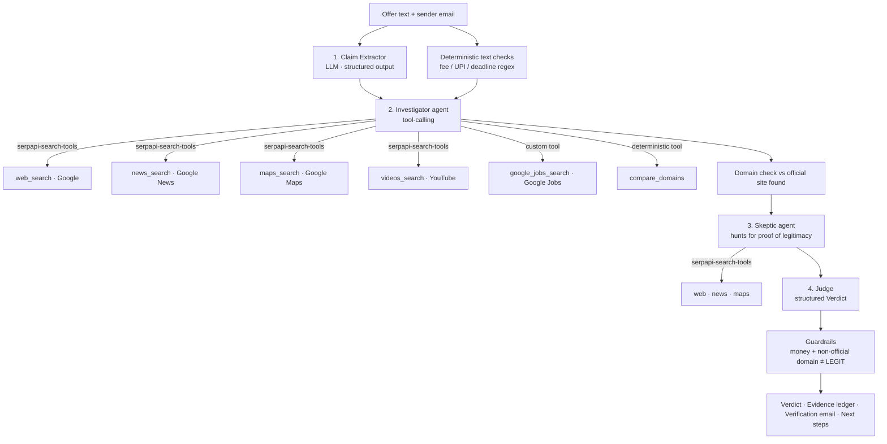

# Parakh 🕵️ — a multi-agent investigator for fake job & internship offers

**SerpApi India Hackathon 2026 · Track: AI Agents**

> **Parakh** (परख) is Hindi for testing whether something is genuine, the way a jeweller tests gold.

- **Live app:** <DEPLOYED URL>
- **Demo video:** <YOUTUBE LINK>

## The problem
Students in India receive fake internship and job offers that impersonate real companies
and ask for a "refundable" registration or laptop deposit over UPI, with a 24-hour deadline.
Existing checkers ask an LLM whether a message *sounds* like a scam. Nobody checks the claims,
so a polished scam passes and a clumsy but genuine startup offer gets flagged.

## The insight
Every offer makes checkable claims: who is hiring, for which role, from which office,
through which email domain. A genuine offer holds up against **live search data**. A fake one does not.
Parakh cross-examines each claim, and an adversarial **Skeptic agent** searches for proof the offer
is genuine, so real employers are not falsely accused.

## What the user gets
1. A live trace of every agent step and every SerpApi search as it happens.
2. A verdict: **LIKELY SCAM / SUSPICIOUS / NOT ENOUGH EVIDENCE / LIKELY LEGIT**, with a 0–100 risk score.
3. An **evidence ledger**: each claim marked ✅ verified, ❌ contradicted or ❔ unverified, with source links.
4. Red flags and signs of legitimacy, side by side.
5. A ready-to-send **verification email** to the company's *official* contact, which the agents found through search.
6. Next steps, including cybercrime.gov.in and the 1930 helpline if money was requested.

## How it works


| Agent | What it does |
|---|---|
| Claim Extractor | Turns a messy WhatsApp or email message into structured, checkable claims |
| Investigator | Plans and runs live searches across 5 SerpApi engines |
| Skeptic | Searches for evidence of legitimacy and challenges each red flag |
| Judge | Produces the verdict, a claim-by-claim evidence ledger and a verification email |

## How SerpApi is used (and why it matters)
| Engine | Via | Why Parakh needs it |
|---|---|---|
| Google Search | `serpapi-search-tools` `web_search` | Find the official website and careers page, plus the company's own fake-offer warnings |
| Google News | `news_search` | Police and media reports of scams using this company's name |
| Google Maps | `maps_search` | "Ghost office" check: is there really an office at the stated address? |
| YouTube | `videos_search` | Scam-exposure videos naming the company or recruiter |
| Google Jobs | custom tool (direct engine call) | Is this role publicly advertised at all? |

All searches go through `CachedBudgetClient`, plugged into `serpapi-search-tools` through its
`client=` hook. It provides:
- a disk cache, so re-runs cost 0 credits
- a per-investigation search budget
- a search log shown in the UI
- graceful failure handling, so a failed search becomes a note for the agent instead of a crash

Without SerpApi, Parakh has no evidence, only guesses.

## Tech stack
- **Backend:** FastAPI (`server.py`). `POST /api/investigate` streams every agent step as Server-Sent Events.
- **Frontend:** hand-built HTML, CSS and JS (`web/`), with no build step. It shows a live pipeline and trace, a risk gauge, an evidence ledger with source links, a copyable verification email and a WhatsApp share button.
- **Agents:** LangChain `create_agent` with Gemini (or Groq), plus `serpapi-search-tools`.

## Run locally
Requires Python 3.10+.
```bash
git clone https://github.com/codebyAtharva09/parakh && cd parakh
python -m venv .venv
source .venv/bin/activate          # Windows: .venv\Scripts\Activate.ps1
pip install -r requirements.txt
cp .env.example .env               # add SERPAPI_API_KEY and a free GOOGLE_API_KEY (or GROQ_API_KEY)
uvicorn server:app --reload        # open http://localhost:8000
```
CLI: `python cli.py samples/scam_impersonation.txt`

## Deploy
**Render (one click):** New → Blueprint → pick this repo. `render.yaml` configures everything.
Paste `SERPAPI_API_KEY` and `GOOGLE_API_KEY` when prompted.

**Anywhere with Docker** (Railway, Fly.io, Hugging Face Spaces): `docker build -t parakh .` then run it with the same env vars.

Public mode (`PARAKH_PUBLIC=1`) protects the search quota. It caps the per-run budget (`PARAKH_MAX_BUDGET`),
always reuses cached searches, and limits each IP to `PARAKH_DAILY_LIMIT` investigations per day.
`PARAKH_LLM_RPM` (default 10) spaces out LLM calls to stay under free-tier rate limits.

## Responsible design
- The verdict cites sources. Every claim check links to evidence.
- The Skeptic agent and the NOT ENOUGH EVIDENCE verdict reduce false accusations against small companies.
- Deterministic guardrails: money requested plus a non-official domain can never be rated "legit".
- Search results are treated as untrusted data (prompt-injection defence).
- Both files in `samples/` are synthetic and labelled as such.
- Public mode protects the shared search quota (budget cap, forced cache, per-IP daily limit).

## Limitations
- Very new or tiny companies may have little online footprint, which leads to NOT ENOUGH EVIDENCE.
- Free LLM tiers can rate-limit. Switch `LLM_PROVIDER` between `gemini` and `groq` in `.env`.

## Roadmap
- Hindi and Marathi output
- Google Lens reverse-image check on recruiter profile photos
- Supplier verification for MSMEs
- A browser extension for Gmail and WhatsApp Web

## AI tools used
- Claude: idea refinement, architecture, code generation and documentation
- Gemini / Groq models run inside the product
