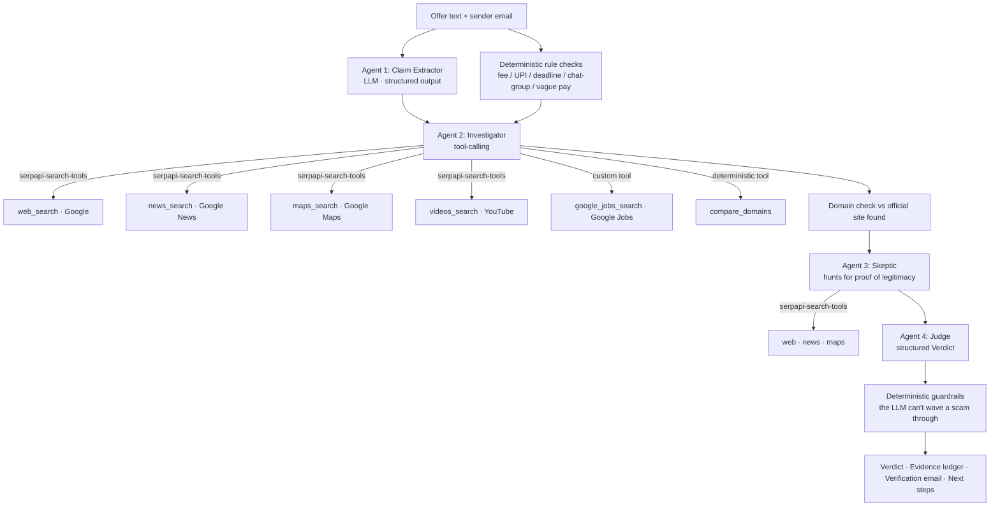

# Touchstone: a multi-agent investigator for fake job & internship offers

**SerpApi India Hackathon 2026 · Track: AI Agents**

> A **touchstone** is the black stone jewellers rub gold against to test whether it's real.
> Touchstone does the same for job offers: it tests every claim against live search data.

- **Team:** Regnum Carya
- **Live app:** https://touchstone-check.vercel.app
- **Demo video:** https://drive.google.com/file/d/1-biYxEVDVp1CsidIFasFdjsI90Mr3hQx/view?usp=sharing

## The problem
Students in India receive fake internship and job offers that impersonate real companies
and ask for a "refundable" registration or laptop deposit over UPI, with a 24-hour deadline.
Existing checkers ask an LLM whether a message *sounds* like a scam. Nobody checks the claims,
so a polished scam passes and a clumsy but genuine startup offer gets flagged.

## The insight
Every offer makes checkable claims: who is hiring, for which role, from which office,
through which email domain. A genuine offer holds up against **live search data**. A fake one does not.
Touchstone cross-examines each claim, and an adversarial **Skeptic agent** searches for proof the offer
is genuine, so real employers are not falsely accused.

## What the user gets
1. A live trace of every agent step and every SerpApi search as it happens.
2. A verdict: **LIKELY SCAM / SUSPICIOUS / NOT ENOUGH EVIDENCE / LIKELY LEGIT**, with a 0–100 risk score.
3. An **evidence ledger**: each claim marked ✅ verified, ❌ contradicted or ❔ unverified, with source links.
4. Red flags and signs of legitimacy, side by side.
5. A ready-to-send **verification email** to the company's *official* contact, which the agents found through search.
6. Next steps, including cybercrime.gov.in and the 1930 helpline if money was requested.

## How it works


| Agent | What it does |
|---|---|
| Claim Extractor | Turns a messy WhatsApp or email message into structured, checkable claims |
| Investigator | Plans and runs live searches across 5 SerpApi engines |
| Skeptic | Searches for evidence of legitimacy and challenges each red flag |
| Judge | Produces the verdict, a claim-by-claim evidence ledger and a verification email |

### What the LLM can't override
Some checks are plain code, so a model can't hallucinate them away:

- **Rule checks** on the message text: fee, deposit and UPI requests; deadlines and "limited seats";
  moving recruitment into a WhatsApp or Telegram group; vague "up to ₹…" or performance-based pay;
  a generic "Dear Candidate" greeting. If the extractor misses the sender email, a regex recovers it.
- **Domain check** (`compare_domains`): the sender's domain against the official website the agents
  found. It flags free mailboxes such as gmail.com and lookalikes such as `infosys-careers.in` vs `infosys.com`.
- **Guardrails** applied after the Judge:
  - money requested plus a non-official email domain is never LIKELY LEGIT or NOT ENOUGH EVIDENCE;
    it is raised to at least SUSPICIOUS
  - recruitment moved into a chat group, or 2+ pressure signals from an unverified sender, is raised to SUSPICIOUS
  - LIKELY LEGIT requires the offer to come from the company's official email domain
  - the risk score is clamped to agree with the verdict (scam 75–100, suspicious 45–74,
    not enough evidence 30–60, legit 0–30)

## How SerpApi is used (and why it matters)
| Engine | Via | Why Touchstone needs it |
|---|---|---|
| Google Search | `serpapi-search-tools` `web_search` | Find the official website and careers page, plus the company's own fake-offer warnings |
| Google News | `news_search` | Police and media reports of scams using this company's name |
| Google Maps | `maps_search` | "Ghost office" check: is there really an office at the stated address? |
| YouTube | `videos_search` | Scam-exposure videos naming the company or recruiter |
| Google Jobs | custom tool (direct engine call) | Is this role publicly advertised at all? |

All searches go through `CachedBudgetClient`, plugged into `serpapi-search-tools` through its
`client=` hook. It provides:
- a disk cache, so re-runs cost 0 credits
- a per-investigation search budget
- a search log shown in the UI
- graceful failure handling, so a failed search becomes a note for the agent instead of a crash
- result trimming: a raw SerpApi Markdown result is about 20 KB, so the client strips metadata and
  tracking links and caps what the LLM sees (`TOUCHSTONE_MAX_RESULT_CHARS`). The full result stays in the cache.

One fresh investigation uses at most 12 live searches (`--budget` / the UI's budget setting).
Re-running the same offer uses 0.

Without SerpApi, Touchstone has no evidence, only guesses.

## Tech stack
- **Backend:** FastAPI (`server.py`). `POST /api/investigate` streams every agent step as Server-Sent Events.
- **Frontend:** React 18 + Framer Motion, built with Vite (`frontend/`). It shows a live agent pipeline and trace, an animated touchstone verdict, an evidence ledger with source links, a copyable verification email and a per-engine SerpApi usage panel. The built files in `frontend/dist` are committed, so the Python deploy needs no Node build step.
- **Agents:** LangChain `create_agent` with Gemini (or Groq), plus `serpapi-search-tools`.
- **Reliability on free models:** a shared rate limiter spaces out LLM calls, an agent that emits a
  malformed tool call is retried once (its searches come back from the cache), Groq uses its strict
  JSON-schema mode for structured output, and if the Judge still fails a rule-based verdict is used.

## Run locally
Requires Python 3.10+.
```bash
git clone https://github.com/codebyAtharva09/touchstone && cd touchstone
python -m venv .venv
source .venv/bin/activate          # Windows: .venv\Scripts\Activate.ps1
pip install -r requirements.txt
cp .env.example .env               # Windows: copy .env.example .env
                                   # then add SERPAPI_API_KEY and a free GOOGLE_API_KEY (or GROQ_API_KEY)
uvicorn server:app --reload        # open http://localhost:8000
```
CLI, handy for quick tests:
```bash
python cli.py samples/scam_impersonation.txt --budget 10
python cli.py my_offer.txt hr@company.com          # optional sender email if it isn't in the text
```

### Settings (`.env`)
| Variable | Default | Purpose |
|---|---|---|
| `SERPAPI_API_KEY` | — | Required. serpapi.com dashboard |
| `LLM_PROVIDER` | `gemini` | `gemini` (recommended) or `groq` |
| `GOOGLE_API_KEY` / `GEMINI_API_KEY` | — | Free key from aistudio.google.com |
| `GEMINI_MODEL` | `gemini-3.5-flash-lite` | Any current Gemini model with tool calling |
| `GROQ_API_KEY` / `GROQ_MODEL` | — / `openai/gpt-oss-120b` | Backup provider, from console.groq.com |
| `TOUCHSTONE_LLM_RPM` | `10` | Max LLM requests per minute |
| `TOUCHSTONE_MAX_RESULT_CHARS` | `4000` (`2200` on Groq) | How much of each search result the LLM sees |
| `TOUCHSTONE_CACHE_DIR` | `.serp_cache` | Search cache location |
| `TOUCHSTONE_PUBLIC`, `TOUCHSTONE_MAX_BUDGET`, `TOUCHSTONE_DAILY_LIMIT` | off, `16`, `3` | Public-deployment quota protection (see Deploy) |

Check your remaining SerpApi credits (free, uses the Account API) at `http://localhost:8000/api/credits`.

Frontend development (hot reload, proxies `/api` to the server on port 8000):
```bash
cd frontend && npm install && npm run dev     # npm run build updates frontend/dist
```

## Deploy
**Vercel (live deployment):** `vercel deploy --prod`. FastAPI runs natively. Set the env vars below, plus `TOUCHSTONE_CACHE_DIR=/tmp/serp_cache`.

**Render (one click):** New → Blueprint → pick this repo. `render.yaml` configures everything.
Paste `SERPAPI_API_KEY` and `GOOGLE_API_KEY` when prompted.

Public mode (`TOUCHSTONE_PUBLIC=1`) protects the search quota. It caps the per-run budget (`TOUCHSTONE_MAX_BUDGET`),
always reuses cached searches, and limits each IP to `TOUCHSTONE_DAILY_LIMIT` investigations per day.
`TOUCHSTONE_LLM_RPM` (default 10) spaces out LLM calls to stay under free-tier rate limits.

## Responsible design
- The verdict cites sources. Every claim check links to evidence.
- The Skeptic agent and the NOT ENOUGH EVIDENCE verdict reduce false accusations against small companies.
- Deterministic guardrails (see above): an offer that asks for money from a non-official domain, or
  moves recruitment into a chat group, can never be rated "legit".
- The Judge may only cite URLs that appeared in the search findings, and claims with no evidence
  are marked unverified instead of being filled in from the model's general knowledge.
- Search results are treated as untrusted data (prompt-injection defence).
- Both files in `samples/` are synthetic and labelled as such.
- Public mode protects the shared search quota (budget cap, forced cache, per-IP daily limit).

## Limitations
- Very new or tiny companies may have little online footprint, which leads to NOT ENOUGH EVIDENCE.
- Free LLM tiers can rate-limit. Switch `LLM_PROVIDER` between `gemini` and `groq` in `.env`.
- Groq's free tier allows only about 8,000 tokens per minute. Touchstone trims results to fit, but
  runs are slower and agents see less evidence, so Gemini is recommended for full investigations.

## Roadmap
- Hindi and Marathi output
- Google Lens reverse-image check on recruiter profile photos
- Supplier verification for MSMEs
- A browser extension for Gmail and WhatsApp Web

## Team Regnum Carya
- Atharva Sarde
- Mrudula Gharat
- Mahi Jain
- Angad Mishra
